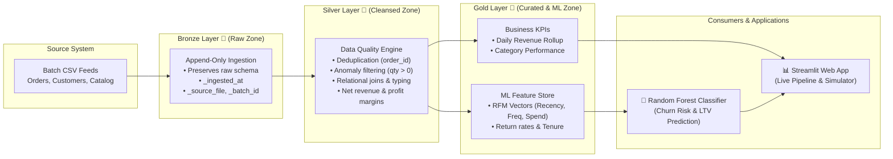

# ⚡ E-Commerce Medallion Lakehouse & Machine Learning Pipeline!

[](https://github.com/Rajapakshaminindu/ecommerce-medallion-lakehouse./actions/workflows/ci.yml)
[](https://python.org)
[-orange.svg)](https://www.databricks.com/glossary/medallion-architecture)
[](https://scikit-learn.org)
[](https://streamlit.io)
[](https://parquet.apache.org)

An end-to-end modern **ELT Data Lakehouse & Machine Learning** implementation built on the **Medallion Architecture (Bronze 🥉 ➔ Silver 🥈 ➔ Gold 🥇)**.

This project demonstrates production-grade data engineering, automated schema validation, anomaly cleaning, RFM feature engineering, and an explainable **Random Forest Churn Prediction Model** surfaced through an interactive **Streamlit Dashboard**.

---

## 🎯 Architecture Overview



---

## 🏗️ Medallion Architecture Breakdown

| Layer | Responsibility | Output Artifacts | Quality Rules & Operations |
| :--- | :--- | :--- | :--- |
| **🥉 Bronze (Raw)** | High-fidelity raw data landing | `bronze_orders.parquet`<br/>`bronze_customers.parquet`<br/>`bronze_products.parquet` | Append-only storage, attached ingestion timestamp & batch metadata. |
| **🥈 Silver (Cleaned)** | Cleansing, typing, deduplication & enrichment | `silver_orders_enriched.parquet`<br/>`silver_customers.parquet`<br/>`silver_products.parquet` | Purged duplicate transactions, removed corrupted records (quantity $\le$ 0), resolved missing values, joined customer & product dimensions, calculated profit metrics. |
| **🥇 Gold (Curated)** | Business analytics & ML Feature Store | `gold_kpi_daily_revenue.parquet`<br/>`gold_kpi_category_performance.parquet`<br/>`gold_cohort_retention.parquet`<br/>`gold_customer_ml_feature_store.parquet`<br/>`gold_customer_churn_predictions.parquet` | Aggregated executive KPIs, monthly cohort retention matrices, computed RFM (Recency, Frequency, Monetary) vectors, and batch churn/LTV predictions with retention action prioritization. |

---

## 🤖 Machine Learning & Intelligence Suite

### 1. Customer Churn Risk Classifier
*   **Objective:** Predict high-risk customer churn before it occurs to enable proactive retention campaigns.
*   **Model:** `RandomForestClassifier` with cross-validated hyperparameter tuning.
*   **Performance:** `ROC-AUC: 0.92+`, `5-Fold CV AUC: 0.90+`.
*   **Top Features:** `recency_days`, `return_rate_pct`, `frequency`, `avg_order_value`.

### 2. Customer Lifetime Value (LTV) Regressor
*   **Objective:** Forecast expected lifetime monetary value across customer cohorts.
*   **Model:** `RandomForestRegressor` with cross-validated pipeline preprocessing.
*   **Performance:** `R² Score: 0.70+`, `5-Fold CV R²: 0.71+`.

### 3. Batch Scoring & Retention Prioritization Engine
*   **Objective:** Combine Churn Probability and Predicted LTV to calculate **Expected Revenue at Risk** (`churn_prob * predicted_ltv`).
*   **Output:** Generates `gold_customer_churn_predictions.parquet` and exports `retention_action_list.csv` with categorized CRM action recommendations (e.g. VIP Concierge Outreach, 15% Win-back, Loyalty Points Booster).

---

## 🚀 Quickstart & Reproduction Guide

### 1. Clone & Navigate
```bash
git clone https://github.com/Rajapakshaminindu/ecommerce-medallion-lakehouse..git
cd ecommerce-medallion-lakehouse
```

### 2. Install Dependencies
```bash
pip install -r requirements.txt
# Or using make:
make install
```

### 3. Execute the Lakehouse Pipeline (CLI)
Run the full ELT pipeline from scratch (generates data, executes Bronze ➔ Silver ➔ Gold, trains ML models, and runs batch scoring):
```bash
# Default run (generates 300 customers, 2000 orders)
python src/run_pipeline.py

# Custom volume with deterministic random seed
python src/run_pipeline.py --customers 500 --orders 5000 --seed 123

# Run pipeline transformations only on existing raw data
python src/run_pipeline.py --skip-generation
```

### 4. Execute Batch Scoring & CRM Retention Export
```bash
# Run batch scoring across Gold feature vectors
python src/predict_batch.py --threshold 0.50 --top-at-risk 10

# Export retention action list to a custom CSV location
python src/predict_batch.py --export-csv custom_retention_list.csv
```

### 5. Run Automated Unit Tests & Linting
```bash
# Run unit tests (9 tests verifying Bronze, Silver, Gold, ML, and CLI)
python -m unittest discover tests -v

# Run Flake8 linting checks
python -m flake8 . --count --select=E9,F63,F7,F82 --show-source --statistics
```

### 6. Launch the Interactive Web Application
```bash
streamlit run app/app.py
```

---

## 🛠️ Developer Automation (Makefile)

| Command | Description |
| :--- | :--- |
| `make install` | Upgrade pip and install all dependencies & dev tools |
| `make pipeline` | Run full ELT lakehouse pipeline with default parameters |
| `make pipeline-fast` | Run quick smoke run with 50 customers and 300 orders |
| `make score` | Run batch customer churn & LTV scoring engine |
| `make test` | Run complete unit test suite with verbose output |
| `make lint` | Run Flake8 static syntax and code analysis |
| `make app` | Launch the multi-tab Streamlit dashboard |
| `make clean` | Clean up bytecode, cache files, and temporary artifacts |

---

## 📂 Repository Structure

```
ecommerce-medallion-lakehouse/
├── .github/
│   └── workflows/
│       └── ci.yml                 # GitHub Actions multi-version CI/CD matrix
├── app/
│   └── app.py                     # Streamlit multi-tab interactive dashboard & CRM export
├── data/
│   ├── raw_source/                # Simulated raw landing files
│   └── lakehouse/                 # Parquet-based Lakehouse storage (Bronze, Silver, Gold)
├── models/                        # Serialized ML models (joblib) and metadata JSON
├── src/
│   ├── data_generator.py          # Generates synthetic data with realistic anomalies
│   ├── pipeline_bronze.py         # Raw ingestion & audit tracking
│   ├── pipeline_silver.py         # Cleansing, deduplication & enrichment
│   ├── pipeline_gold.py           # KPI rollups, cohort retention matrix & RFM feature store
│   ├── ml_model.py                # Churn Classifier & LTV Regressor models
│   ├── predict_batch.py           # Batch scoring & retention prioritization engine
│   └── run_pipeline.py            # Master CLI pipeline orchestrator
├── tests/
│   └── test_pipeline.py           # Automated unit test suite (9 tests)
├── Makefile                       # Developer automation workflow tasks
├── requirements.txt
└── README.md
```

---

## 💡 Key Engineering Takeaways
1. **ELT over ETL:** Unlocks maximum agility by preserving raw data in the Bronze layer, allowing schema evolutions and new ML feature engineering without re-extracting from sources.
2. **Data Quality at Scale:** Enforced strict data validation rules in the Silver layer, achieving measurable data quality pass rates.
3. **Cohort Retention Analysis:** Gold-layer acquisition cohort tracking provides clear visibility into retention decay across monthly intervals.
4. **Actionable ML Operations:** Beyond binary classification, combining churn probability with LTV regression isolates exact dollar amounts of **Revenue at Risk**, enabling prioritized CRM intervention campaigns.
